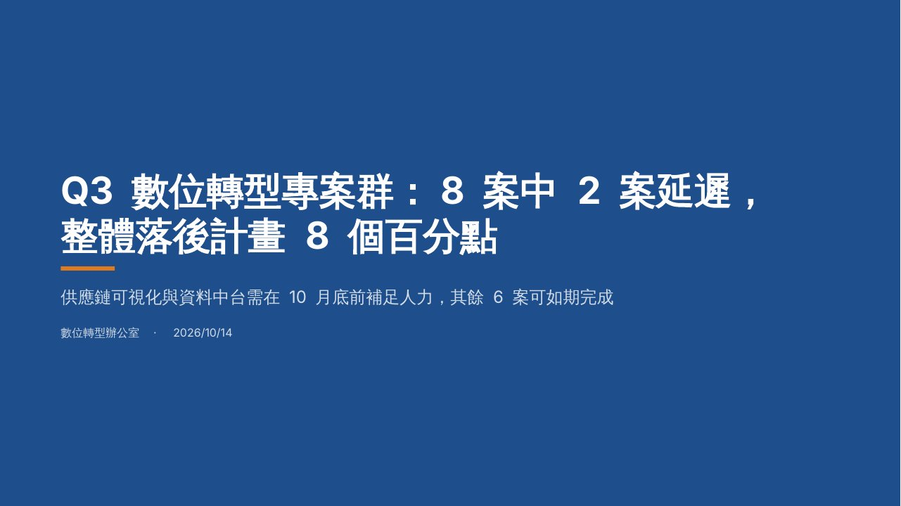
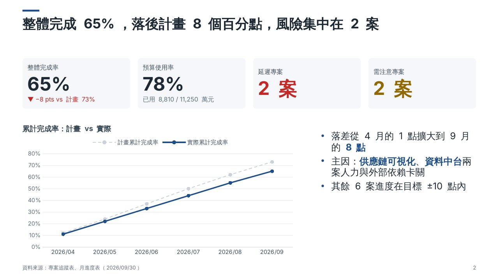
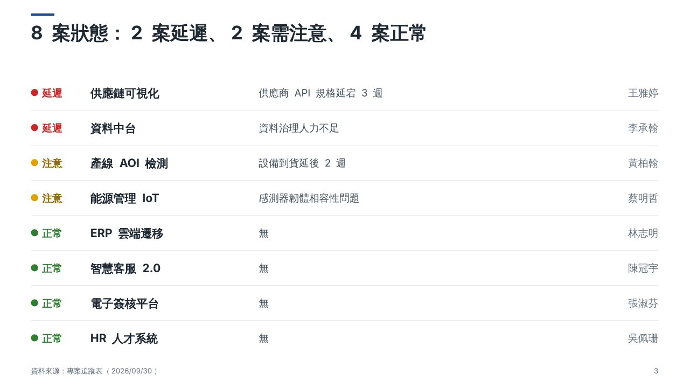
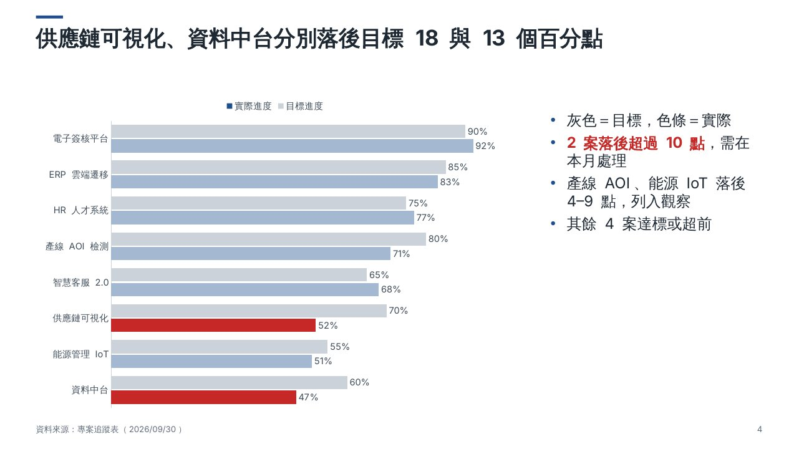
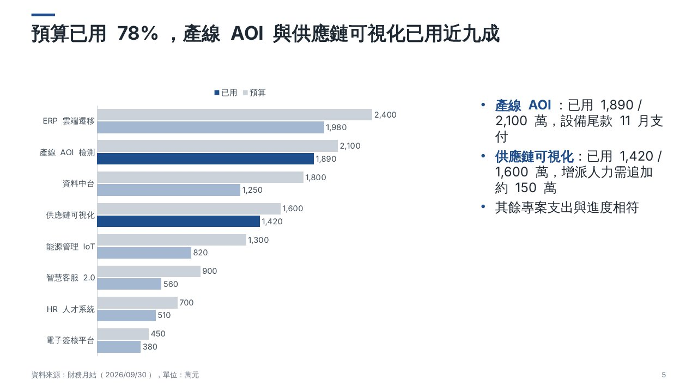
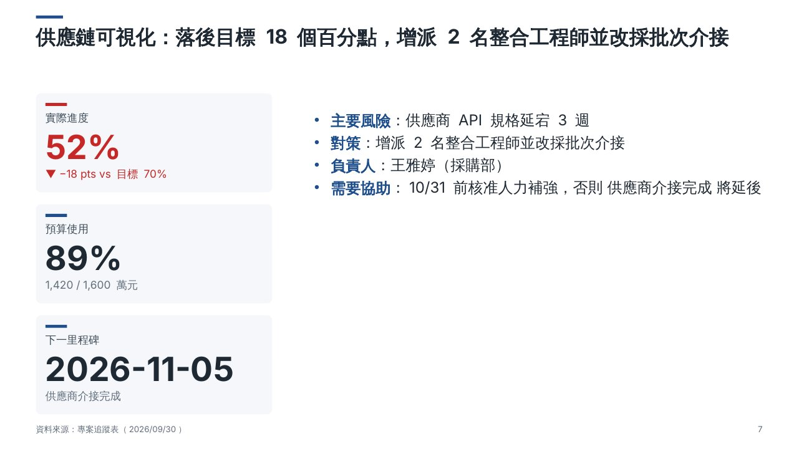
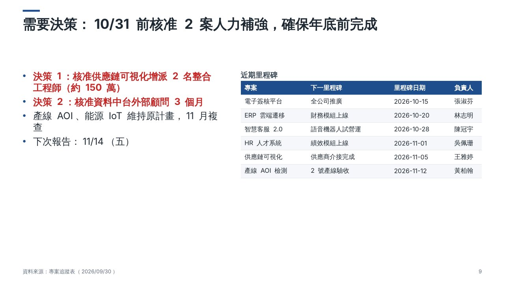

# Claude Design vs ReportDesign MCP：同題對比

目的：用**同一份題目、同一份資料、同一組視覺規格**，分別交給 Claude Design 和本工具（Copilot＋ReportDesign MCP），並排比較設計品質。

| 檔案 | 內容 |
|---|---|
| `brief.md` | 共用題目（兩邊一字不改） |
| `data/projects.csv`、`data/monthly_progress.csv` | 共用資料 |
| `mcp_reference_spec.json` | 本工具的「標準答案」spec：依視覺設計指引寫出的理想版本，用來確認引擎能做到的上限 |
| `mcp_reference/slide_*.jpg` | 標準答案的渲染圖（在 Linux 用 LibreOffice 轉出，中文字型以文泉驛代替微軟正黑體，實際 PowerPoint 會更細緻） |

## 步驟

### A. Claude Design
1. 到 claude.ai 開 Claude Design，上傳 `data/projects.csv`、`data/monthly_progress.csv`。
2. 貼上下面的 prompt（後半段就是 `brief.md` 全文）：
   ```
   請依照以下題目製作簡報，完成後匯出 .pptx。
   <貼上 brief.md 全文>
   ```
3. 匯出 .pptx，存成 `benchmark/results/claude_design.pptx`。不要手動修改。

### B. ReportDesign MCP（VS Code Copilot，Agent 模式）
1. 確認 `design_system/theme.yaml` 是預設值（主色 1E4E8C），`design_system/templates/` 沒有放公司範本。
2. 在 Copilot Chat 貼上：
   ```
   用 ReportDesign MCP 製作簡報，sources 用 benchmark/data/projects.csv 和 benchmark/data/monthly_progress.csv，
   audience 用 manager，輸出到 benchmark/results/。依照以下題目：
   <貼上 brief.md 全文>
   ```
3. 讓 Copilot 跑完 `get_design_context → build_deck → preview_deck → patch_deck` 自我檢查流程，不要手動修改。**不要**把 `mcp_reference_spec.json` 加進對話（那是標準答案）。
4. 另外也產一份標準答案，看引擎的上限：
   ```bat
   .venv\Scripts\python cli.py build benchmark\mcp_reference_spec.json -o benchmark\results\mcp_reference.pptx
   ```

### C. 並排比較
```bat
.venv\Scripts\python cli.py preview benchmark\results\claude_design.pptx --out benchmark\results\cd_png
.venv\Scripts\python cli.py preview benchmark\results\<Copilot 產出的檔名>.pptx --out benchmark\results\mcp_png
```
兩邊同一頁並排，用下表評分。`preview` 的版面檢查也可以當客觀指標（⚠ 數量越少越好）。

## 評分表（每項 1–5 分）

| # | 項目 | 5 分的樣子 |
|---|---|---|
| 1 | 結論式標題 | 每頁標題就是結論，只看標題就能串起整個故事 |
| 2 | 視覺層級 | 3 秒內看得出重點：標題 → 大數字／圖 → 說明 |
| 3 | 元件選擇 | 趨勢用折線、比較用排序過的橫條、狀態用燈號、關鍵數字用 KPI 卡，沒有硬塞條列 |
| 4 | 色彩紀律 | 主色只用在重點，紅色只用在問題，其餘是灰階；圖表有重點著色 |
| 5 | 留白與對齊 | 元件對齊同一組格線，邊界一致，不擠也不空 |
| 6 | 一致性 | 整份字級、卡片、圖表樣式、頁碼與資料來源位置一致 |
| 7 | 數字正確 | 所有數字和 CSV 一致（逐一核對 KPI、圖表標籤、表格） |
| 8 | 可讀性 | 最小字 ≥ 10pt，文字與底色對比足夠，圖表標籤讀得到 |
| 9 | 節奏 | 封面、章節頁、內容頁有變化，連續頁不會長得一模一樣 |
| 10 | 可編輯性 | 原生 PowerPoint 文字、圖表（可改資料）、表格，不是整頁圖片 |

**判定「效果相近」**：兩邊總分差 ≤ 5 分（滿分 50），且第 2、4、6 項各差 ≤ 1 分。若 MCP 在某項落後超過 1 分，把那頁截圖和分數記下來；多半能用以下方式補上：
- 元件／排法的問題 → 補充 `report_engine/guides/visual_guide.md` 或在 `design_system/examples/` 放一份好範例
- 樣式的問題（顏色、字級、間距） → 調整 `design_system/theme.yaml`
- 引擎做不到的樣式 → 回報需求，改 `report_engine/renderer.py`

## 標準答案預覽
| | |
|---|---|
|  |  |
|  |  |
|  |  |
|  |  |
